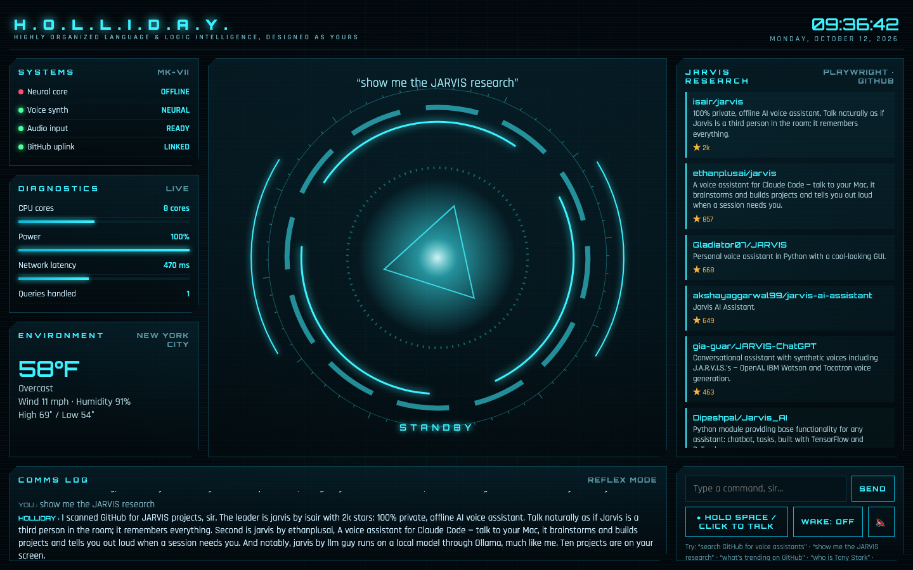

# H.O.L.L.I.D.A.Y.
**Highly Organized Language & Logic Intelligence, Designed As Yours.** An Iron-Man-style voice assistant that runs in one HTML file.



## What it does
- **Talk to it.** Hold Space or click to speak (Web Speech API), or turn on wake-word mode and just say "Holliday…". It answers out loud with a neural voice.
- **Local brain.** Conversation runs on a local LLM through [Ollama](https://ollama.com) (Llama 3.2), streamed **sentence by sentence** into the speech engine so it starts talking almost immediately.
- **Live skills** that answer instantly without the LLM: GitHub repository search and "what's trending this week" (GitHub REST API), Wikipedia lookups, local weather (Open-Meteo), opening websites, time and date, and system diagnostics.
- **Research briefing.** I used Playwright to scrape GitHub for the most-starred JARVIS-style assistants. Say "show me the JARVIS research" and it briefs you on them.
- **Arc-reactor HUD.** A canvas animation that reacts to the voice's audio spectrum while it speaks.
- **Graceful fallbacks.** If the LLM is slow or offline, it says so and keeps working on its built-in skills. If the neural voice server is down, it switches to the system voice.

## Run it
```bash
ollama pull llama3.2:1b                 # the brain
python3 -m http.server 7900             # serve this folder
# open http://localhost:7900 in Chrome and click to start
```
Optional neural voice: a [Kokoro TTS](https://github.com/thewh1teagle/kokoro-onnx) server on port 8880 exposing `/tts?voice=bf_emma&text=...`.

Built with vanilla JavaScript, Canvas, Web Speech, Web Audio, the Ollama API and Playwright, with help from AI coding tools (Claude Code).
